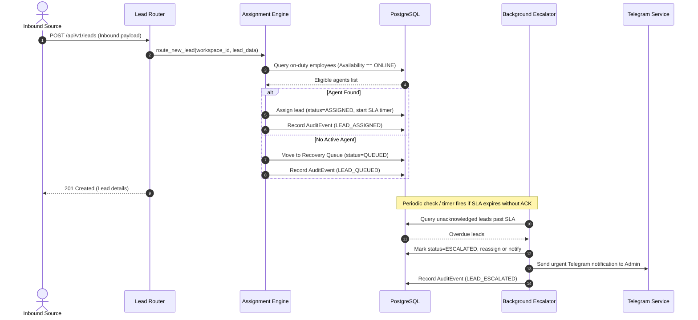

# LeadFlow — System Architecture

## 1. High-Level System Architecture

LeadFlow is designed as a decoupled, multi-tenant monorepo architecture consisting of a modern single-page frontend (React + TypeScript + Tailwind CSS), a high-performance RESTful API backend (FastAPI + SQLAlchemy + Pydantic), a relational datastore (PostgreSQL), and asynchronous integration adapters for external services.

```text
┌────────────────────────────────────────────────────────────────────────┐
│                          Client Layer (Web UI)                         │
│   React 18+ (Vite, TypeScript, Tailwind CSS, React Router, Lucide)     │
└───────────────────────────────────┬────────────────────────────────────┘
                                    │ HTTPS / REST (JSON)
                                    │ Headers: Authorization (Bearer)
                                    │          X-Workspace-ID (Tenant)
┌───────────────────────────────────▼────────────────────────────────────┐
│                       FastAPI Application Tier                         │
│  ┌──────────────────────────────────────────────────────────────────┐  │
│  │ Middlewares: CORS, Request Tracing, Workspace Tenant Context     │  │
│  └──────────────────────────────────┬───────────────────────────────┘  │
│                                     ▼                                  │
│  ┌──────────────────────────────────────────────────────────────────┐  │
│  │ Routers / Controllers (Auth, CRM, Leads, Integrations, Analytics)│  │
│  └──────────────────────────────────┬───────────────────────────────┘  │
│                                     ▼                                  │
│  ┌──────────────────────────────────────────────────────────────────┐  │
│  │ Domain Service Layer (Assignment Engine, Escalator, Audit Ledger)│  │
│  └─────────────────┬───────────────────────────────┬────────────────┘  │
│                    ▼                               ▼                   │
│  ┌─────────────────────────────────┐ ┌──────────────────────────────┐  │
│  │ Data Access Layer (SQLAlchemy 2)│ │ Third-Party Integrations     │  │
│  └─────────────────┬───────────────┘ └─────────────┬────────────────┘  │
└────────────────────┼───────────────────────────────┼───────────────────┘
                     │ SQL (asyncpg/psycopg2)        │ REST / Webhooks
┌────────────────────▼──────────────┐ ┌──────────────▼───────────────────┐
│       Relational Datastore        │ │     External Cloud Services      │
│     PostgreSQL 16 Multi-Tenant    │ │  • Twilio (SMS / WhatsApp)       │
│  (Isolated via workspace_id FKey) │ │  • Stripe (Payments)             │
│                                   │ │  • Google Calendar (OAuth 2.0)   │
│                                   │ │  • Telegram (Bot API)            │
└───────────────────────────────────┘ └──────────────────────────────────┘
```

---

## 2. Multi-Tenancy & Workspace Isolation Strategy

Tenant isolation is fundamental to LeadFlow's data security model:

1. **Logical Separation**: Every business tenant operates within a distinct `Workspace`.
2. **Mandatory Foreign Keys**: Every tenant-scoped entity (Contacts, Deals, Leads, Invoices, Messages, Audit Logs) enforces a non-nullable `workspace_id UUID REFERENCES workspaces(id)`.
3. **Context Injection Middleware**:
   - The FastAPI request pipeline extracts the active `workspace_id` from the authenticated user's JWT token and validates the optional `X-Workspace-ID` header.
   - A Python `contextvars.ContextVar` stores this workspace identifier for the lifetime of the request.
4. **Data Access Enforcement**:
   - Repository/Service methods must filter by `workspace_id`.
   - Direct database access across different workspaces without explicit super-admin privileges raises an unhandled authorization fault (`403 Forbidden`).

---

## 3. Backend Architectural Layers

The backend follows a modular, layered design with clear separation of responsibilities:

- **`app/core/`**: Configuration via `pydantic-settings`, cryptographic utilities (JWT signing, password hashing), and application-wide logging.
- **`app/database/`**: SQLAlchemy engine configuration, connection pooling, and base model classes.
- **`app/middleware/`**: Cross-cutting concerns including CORS management, structured exception handlers, request timing, and workspace context population.
- **`app/models/`**: Declarative SQLAlchemy ORM models representing the physical database schema.
- **`app/schemas/`**: Pydantic models for request validation, query parameters, and response serialization.
- **`app/routers/`**: REST HTTP endpoint definitions organized by domain, decoupled from direct database queries.
- **`app/services/`**: Pure business logic, transactional workflows (e.g., lead assignment algorithms, escalation timers), and domain rules.
- **`app/integrations/`**: Encapsulated clients and webhook handlers for external platforms (Twilio, Stripe, Google, Telegram).

---

## 4. Frontend Architecture

The frontend is constructed as a modern, responsive Single Page Application (SPA):

- **Build Tool**: Vite provides near-instant HMR (Hot Module Replacement) and optimized production bundles.
- **Design System**: Tailwind CSS utility classes organized with reusable UI primitives in `src/components/ui/` and composite layouts in `src/components/layout/`.
- **Navigation & Routing**: React Router v6 provides client-side routing, protected routes (guards), and layout nesting.
- **API Communication**: Centralized Axios client (`src/api/client.ts`) configured with base URLs, automatic request interceptors for Authorization Bearer tokens and `X-Workspace-ID` headers, and global error handling interceptors.
- **State Management**: React Context providers manage global application concerns (Authentication, Current Workspace, Active Toast Notifications).

---

## 5. Architectural Sequence Flows

### 5.1 Lead Intake, Automated Assignment & Escalation


---

## 6. Security & Operational Standards

1. **Zero Credential Ingestion**: No production or test secrets are checked into version control. Environment templates (`.env.example`) provide documentation.
2. **Immutability**: Audit log records (`AuditEvent`) permit append-only operations. `UPDATE` and `DELETE` operations on audit tables are disallowed.
3. **Resilience**: Outbound calls to third-party APIs must use timeouts (max 5s) and catch network exceptions gracefully.
