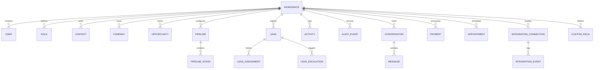

# LeadFlow — Database Schema & Entity Specification

> **Notice:** This document defines the architectural blueprint and entity specifications for LeadFlow. The physical SQLAlchemy models and Alembic migrations will be implemented and maintained by **Member 2 (Core Backend)**.

---

## 1. Multi-Tenant Architecture & Isolation Rules

1. **Workspace Isolation**: All operational entities must contain a non-nullable `workspace_id UUID REFERENCES workspaces(id) ON DELETE CASCADE`.
2. **Compound Indexing**: All tenant-scoped tables must index `(workspace_id, id)` or `(workspace_id, created_at)` to guarantee high-performance query execution and strict partitioning.
3. **UUID Primary Keys**: All entities use UUID v4 (`id UUID PRIMARY KEY DEFAULT gen_random_uuid()`) to prevent enumeration attacks and support distributed synchronization.
4. **Audit Columns**: Every entity inherits `created_at TIMESTAMPTZ NOT NULL DEFAULT NOW()` and `updated_at TIMESTAMPTZ NOT NULL DEFAULT NOW()`.

---

## 2. Entity Relationship Overview



---

## 3. Entity Catalog (20 Planned Entities)

### 3.1 Tenancy & Identity
1. **Workspace (`workspaces`)**
   - `id`: UUID (PK)
   - `name`: VARCHAR(255) NOT NULL
   - `slug`: VARCHAR(100) UNIQUE NOT NULL
   - `plan`: VARCHAR(50) DEFAULT 'free' (free, starter, pro, enterprise)
   - `settings`: JSONB DEFAULT '{}'
   - `is_active`: BOOLEAN DEFAULT true
   - `created_at`, `updated_at`: TIMESTAMPTZ

2. **User (`users`)**
   - `id`: UUID (PK)
   - `email`: VARCHAR(255) UNIQUE NOT NULL
   - `hashed_password`: VARCHAR(255) NOT NULL
   - `first_name`: VARCHAR(100) NOT NULL
   - `last_name`: VARCHAR(100) NOT NULL
   - `phone_number`: VARCHAR(50)
   - `is_active`: BOOLEAN DEFAULT true
   - `is_superuser`: BOOLEAN DEFAULT false
   - `created_at`, `updated_at`: TIMESTAMPTZ

3. **Role / Permission (`roles`, `user_workspace_roles`)**
   - `id`: UUID (PK)
   - `workspace_id`: UUID (FK -> workspaces.id)
   - `name`: VARCHAR(100) NOT NULL (e.g., "Owner", "Admin", "Sales Rep", "Support")
   - `permissions`: JSONB NOT NULL (e.g., `["crm:read", "crm:write", "leads:assign", "payments:manage"]`)
   - `is_system_role`: BOOLEAN DEFAULT false
   - `created_at`, `updated_at`: TIMESTAMPTZ

### 3.2 CRM & Pipeline Domain
4. **Company (`companies`)**
   - `id`: UUID (PK)
   - `workspace_id`: UUID (FK -> workspaces.id, Index)
   - `name`: VARCHAR(255) NOT NULL
   - `domain`: VARCHAR(255)
   - `industry`: VARCHAR(100)
   - `phone`: VARCHAR(50)
   - `address`: JSONB
   - `created_at`, `updated_at`: TIMESTAMPTZ

5. **Contact (`contacts`)**
   - `id`: UUID (PK)
   - `workspace_id`: UUID (FK -> workspaces.id, Index)
   - `company_id`: UUID (FK -> companies.id, Nullable)
   - `first_name`: VARCHAR(100) NOT NULL
   - `last_name`: VARCHAR(100)
   - `email`: VARCHAR(255)
   - `phone`: VARCHAR(50)
   - `custom_attributes`: JSONB DEFAULT '{}'
   - `created_at`, `updated_at`: TIMESTAMPTZ

6. **Pipeline (`pipelines`)**
   - `id`: UUID (PK)
   - `workspace_id`: UUID (FK -> workspaces.id, Index)
   - `name`: VARCHAR(150) NOT NULL
   - `is_default`: BOOLEAN DEFAULT false
   - `created_at`, `updated_at`: TIMESTAMPTZ

7. **PipelineStage (`pipeline_stages`)**
   - `id`: UUID (PK)
   - `pipeline_id`: UUID (FK -> pipelines.id, Index)
   - `name`: VARCHAR(100) NOT NULL (e.g., "New", "Contacted", "Proposal Sent", "Closed Won")
   - `stage_order`: INTEGER NOT NULL
   - `win_probability`: NUMERIC(5,2) DEFAULT 0.00
   - `is_closed_won`: BOOLEAN DEFAULT false
   - `is_closed_lost`: BOOLEAN DEFAULT false
   - `created_at`, `updated_at`: TIMESTAMPTZ

8. **Opportunity (`opportunities`)**
   - `id`: UUID (PK)
   - `workspace_id`: UUID (FK -> workspaces.id, Index)
   - `contact_id`: UUID (FK -> contacts.id, Nullable)
   - `company_id`: UUID (FK -> companies.id, Nullable)
   - `pipeline_stage_id`: UUID (FK -> pipeline_stages.id)
   - `assigned_user_id`: UUID (FK -> users.id, Nullable)
   - `title`: VARCHAR(255) NOT NULL
   - `estimated_value`: NUMERIC(12,2) DEFAULT 0.00
   - `currency`: VARCHAR(3) DEFAULT 'USD'
   - `expected_close_date`: DATE
   - `status`: VARCHAR(50) DEFAULT 'open' (open, won, lost, abandoned)
   - `created_at`, `updated_at`: TIMESTAMPTZ

9. **CustomField (`custom_fields`)**
   - `id`: UUID (PK)
   - `workspace_id`: UUID (FK -> workspaces.id, Index)
   - `entity_type`: VARCHAR(50) NOT NULL (contact, company, lead, opportunity)
   - `field_key`: VARCHAR(100) NOT NULL
   - `field_label`: VARCHAR(150) NOT NULL
   - `field_type`: VARCHAR(50) NOT NULL (text, number, date, select, boolean)
   - `options`: JSONB DEFAULT '[]'
   - `is_required`: BOOLEAN DEFAULT false
   - `created_at`, `updated_at`: TIMESTAMPTZ

### 3.3 Lead Routing & Escalation Domain
10. **Lead (`leads`)**
    - `id`: UUID (PK)
    - `workspace_id`: UUID (FK -> workspaces.id, Index)
    - `source`: VARCHAR(100) NOT NULL (website, twilio, manual, webhook)
    - `full_name`: VARCHAR(200) NOT NULL
    - `email`: VARCHAR(255)
    - `phone`: VARCHAR(50)
    - `notes`: TEXT
    - `status`: VARCHAR(50) DEFAULT 'new' (new, assigned, acknowledged, contacted, qualified, disqualified, queued, escalated)
    - `score`: INTEGER DEFAULT 0
    - `sla_acknowledgement_due_at`: TIMESTAMPTZ
    - `acknowledged_at`: TIMESTAMPTZ
    - `assigned_user_id`: UUID (FK -> users.id, Nullable, Index)
    - `created_at`, `updated_at`: TIMESTAMPTZ

11. **LeadAssignment (`lead_assignments`)**
    - `id`: UUID (PK)
    - `lead_id`: UUID (FK -> leads.id, Index)
    - `assigned_to_user_id`: UUID (FK -> users.id)
    - `assigned_by_user_id`: UUID (FK -> users.id, Nullable)
    - `assigned_at`: TIMESTAMPTZ NOT NULL DEFAULT NOW()
    - `assignment_rule`: VARCHAR(100) DEFAULT 'round-robin'
    - `acknowledged_at`: TIMESTAMPTZ
    - `status`: VARCHAR(50) DEFAULT 'pending' (pending, acknowledged, expired, reassigned)

12. **LeadEscalation (`lead_escalations`)**
    - `id`: UUID (PK)
    - `lead_id`: UUID (FK -> leads.id, Index)
    - `escalation_level`: INTEGER DEFAULT 1
    - `reason`: VARCHAR(255) NOT NULL (sla_breached, agent_declined, recovery_timeout)
    - `previous_user_id`: UUID (FK -> users.id, Nullable)
    - `escalated_to_user_id`: UUID (FK -> users.id, Nullable)
    - `notified_via`: VARCHAR(50) (telegram, sms, email)
    - `resolved_at`: TIMESTAMPTZ
    - `created_at`: TIMESTAMPTZ NOT NULL DEFAULT NOW()

### 3.4 Operational Activities & Audit
13. **Activity (`activities`)**
    - `id`: UUID (PK)
    - `workspace_id`: UUID (FK -> workspaces.id, Index)
    - `user_id`: UUID (FK -> users.id)
    - `entity_type`: VARCHAR(50) NOT NULL (contact, opportunity, lead)
    - `entity_id`: UUID NOT NULL
    - `activity_type`: VARCHAR(50) NOT NULL (call, email, note, task, meeting)
    - `description`: TEXT NOT NULL
    - `due_date`: TIMESTAMPTZ
    - `is_completed`: BOOLEAN DEFAULT false
    - `created_at`, `updated_at`: TIMESTAMPTZ

14. **AuditEvent (`audit_events`)** — *Immutable ledger*
    - `id`: UUID (PK)
    - `workspace_id`: UUID (FK -> workspaces.id, Index)
    - `actor_id`: UUID (FK -> users.id, Nullable)
    - `action`: VARCHAR(100) NOT NULL (e.g. `USER_ROLE_UPDATED`, `LEAD_ESCALATED`, `PAYMENT_RECEIVED`)
    - `resource_type`: VARCHAR(50) NOT NULL
    - `resource_id`: VARCHAR(100) NOT NULL
    - `diff_before`: JSONB
    - `diff_after`: JSONB
    - `ip_address`: VARCHAR(45)
    - `user_agent`: TEXT
    - `created_at`: TIMESTAMPTZ NOT NULL DEFAULT NOW()

### 3.5 Messaging & Communications
15. **Conversation (`conversations`)**
    - `id`: UUID (PK)
    - `workspace_id`: UUID (FK -> workspaces.id, Index)
    - `channel`: VARCHAR(50) NOT NULL (sms, whatsapp, email)
    - `external_thread_id`: VARCHAR(255)
    - `contact_id`: UUID (FK -> contacts.id, Nullable)
    - `status`: VARCHAR(50) DEFAULT 'active' (active, closed, archived)
    - `created_at`, `updated_at`: TIMESTAMPTZ

16. **Message (`messages`)**
    - `id`: UUID (PK)
    - `conversation_id`: UUID (FK -> conversations.id, Index)
    - `sender_type`: VARCHAR(50) NOT NULL (user, contact, system)
    - `sender_id`: VARCHAR(100)
    - `body`: TEXT NOT NULL
    - `delivery_status`: VARCHAR(50) DEFAULT 'sent' (pending, sent, delivered, failed)
    - `external_message_id`: VARCHAR(255)
    - `created_at`: TIMESTAMPTZ NOT NULL DEFAULT NOW()

### 3.6 Payments & Financials
17. **Payment (`payments`)**
    - `id`: UUID (PK)
    - `workspace_id`: UUID (FK -> workspaces.id, Index)
    - `opportunity_id`: UUID (FK -> opportunities.id, Nullable)
    - `contact_id`: UUID (FK -> contacts.id, Nullable)
    - `amount`: NUMERIC(12,2) NOT NULL
    - `currency`: VARCHAR(3) DEFAULT 'USD'
    - `payment_method`: VARCHAR(50) DEFAULT 'stripe'
    - `stripe_payment_intent_id`: VARCHAR(255)
    - `status`: VARCHAR(50) DEFAULT 'pending' (pending, succeeded, failed, refunded)
    - `receipt_url`: TEXT
    - `created_at`, `updated_at`: TIMESTAMPTZ

### 3.7 Scheduling & External Integrations
18. **Appointment (`appointments`)**
    - `id`: UUID (PK)
    - `workspace_id`: UUID (FK -> workspaces.id, Index)
    - `title`: VARCHAR(255) NOT NULL
    - `start_time`: TIMESTAMPTZ NOT NULL
    - `end_time`: TIMESTAMPTZ NOT NULL
    - `assigned_user_id`: UUID (FK -> users.id)
    - `contact_id`: UUID (FK -> contacts.id, Nullable)
    - `google_calendar_event_id`: VARCHAR(255)
    - `meet_url`: TEXT
    - `status`: VARCHAR(50) DEFAULT 'scheduled' (scheduled, completed, cancelled, no-show)
    - `created_at`, `updated_at`: TIMESTAMPTZ

19. **IntegrationConnection (`integration_connections`)**
    - `id`: UUID (PK)
    - `workspace_id`: UUID (FK -> workspaces.id, Index)
    - `provider`: VARCHAR(50) NOT NULL (twilio, stripe, google_calendar, telegram)
    - `status`: VARCHAR(50) DEFAULT 'connected' (connected, disconnected, error)
    - `credentials_encrypted`: TEXT (Encrypted OAuth tokens / API keys)
    - `config`: JSONB DEFAULT '{}'
    - `last_sync_at`: TIMESTAMPTZ
    - `created_at`, `updated_at`: TIMESTAMPTZ

20. **IntegrationEvent (`integration_events`)**
    - `id`: UUID (PK)
    - `workspace_id`: UUID (FK -> workspaces.id, Index)
    - `integration_connection_id`: UUID (FK -> integration_connections.id)
    - `event_type`: VARCHAR(100) NOT NULL (e.g. `webhook.received`, `sync.completed`, `error.rate_limited`)
    - `payload`: JSONB NOT NULL
    - `processed`: BOOLEAN DEFAULT false
    - `created_at`: TIMESTAMPTZ NOT NULL DEFAULT NOW()

---

## 4. Alembic Migration Setup (Instructions for Member 2)

Member 2 will generate the initial physical migration:
```bash
cd backend
# With virtual environment activated:
alembic revision --autogenerate -m "create_initial_leadflow_schema"
alembic upgrade head
```
All migration revisions must include both forward (`upgrade()`) and rollback (`downgrade()`) procedures.
